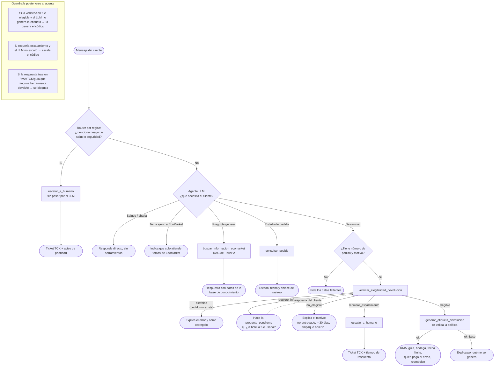

# Proyecto Final — Fase 1: Diseño de la arquitectura del agente

## 1. Objetivo

En los Talleres 1 y 2 el asistente de EcoMarket era **reactivo**: respondía preguntas
(con prompts mejorados en el Taller 1 y con RAG en el Taller 2) y, para devoluciones,
solo podía *explicar* la política. El cliente seguía teniendo que escribir a soporte
para que un humano validara el caso y le enviara la guía de envío.

El Proyecto Final convierte el asistente en un **agente**: un LLM que, además de
conversar, decide **qué acción ejecutar** (consultar un pedido, verificar si una
devolución procede, generar la etiqueta, escalar a un humano) y la ejecuta a través
de **herramientas** (funciones de código que simulan los sistemas internos de EcoMarket).

## 2. Extensión de la arquitectura RAG

El enunciado plantea dos opciones: incorporar el RAG como **una herramienta más** del
agente, o como **una ruta alterna** decidida por reglas (arquitectura *router*). Se
eligió un diseño **híbrido**, que toma lo mejor de cada una:

| Componente | Tipo | Por qué |
|---|---|---|
| RAG del Taller 2 → `buscar_informacion_ecomarket` | **Herramienta** | La decisión "¿esto es una pregunta general o una acción?" depende del significado del mensaje, no de palabras clave; es justo lo que un LLM hace bien. Así el agente puede, por ejemplo, consultar la política *y* luego tramitar la devolución en la misma conversación. |
| Reportes de riesgo para la salud/seguridad | **Ruta por reglas** (router) | La sección 3 de la política exige que estos casos *siempre* los atienda un humano. No se puede dejar esa decisión a un modelo de 3B parámetros que podría no reconocerla; una regla determinística (expresión regular: "quemé", "intoxicación", "alergia", "explotó"...) los desvía directo a `escalar_a_humano` **sin pasar por el LLM**. |
| Reglas de elegibilidad de devolución | **Código determinístico** dentro de las herramientas | Igual que en el Taller 2 (donde el estado de un pedido se resolvía con búsqueda exacta y no con embeddings), una decisión con consecuencias económicas no debe depender de que el LLM "interprete" la política. El LLM solo extrae los datos (pedido, motivo, empaque abierto, producto usado); el código aplica la política. |

Es decir: **el LLM decide *qué* hacer y *cómo comunicarlo*; el código decide *si se puede*.**

## 3. Definición de las herramientas

Se definieron **5 herramientas**: 4 nuevas (el mínimo exigido es 2) más el RAG
existente. Todas devuelven un diccionario JSON con un campo `ok`. Si es `false`,
traen un código `error` y un `mensaje` legible, para que el agente pueda explicar el
fallo en vez de romperse.

### 3.1 `buscar_informacion_ecomarket` (RAG del Taller 2, reutilizado)

| | |
|---|---|
| **Cuándo** | Preguntas generales: envíos, pagos, cuenta, catálogo (precio/stock), política en general. |
| **Entrada** | `pregunta: str` |
| **Salida éxito** | `{"ok": true, "respuesta": "<texto generado con el contexto recuperado>"}` |
| **Salida error** | `{"ok": false, "error": "sin_informacion", ...}` cuando la "puerta de relevancia" del Taller 2 (distancia L2 > 25) detecta que la base de conocimiento no cubre la pregunta. |
| **Implementación** | Reutiliza `load_index()`, `build_rag_chain()` y `has_relevant_context()` de `src/rag/` sin duplicar código. |

### 3.2 `consultar_pedido`

| | |
|---|---|
| **Cuándo** | El cliente pregunta por el estado de un pedido. |
| **Entrada** | `numero_pedido: str` (formato `ECO` + 4 dígitos) |
| **Salida éxito** | `{"ok": true, "numero_pedido", "producto", "categoria", "cantidad", "estado", "fecha_estimada_entrega", "fecha_entrega", "enlace_rastreo", "motivo_retraso"?}` |
| **Salida error** | `{"ok": false, "error": "pedido_no_encontrado", "mensaje": ...}` |

### 3.3 `verificar_elegibilidad_devolucion` (nueva, núcleo del proceso)

| | |
|---|---|
| **Cuándo** | Siempre antes de generar una etiqueta. |
| **Entrada** | `numero_pedido: str`, `motivo: "defecto_fabrica" \| "danado_en_transito" \| "producto_equivocado" \| "cambio_de_opinion"`, `empaque_abierto: bool \| null`, `producto_usado: bool \| null` |
| **Salida** | `{"ok": true, "decision", "elegible", "explicacion", "siguiente_paso", "pregunta_pendiente"?, "producto", "categoria", "valor_pedido_cop", "dias_desde_entrega", "politica_aplicada", "costo_envio_retorno"}` |
| **Errores** | `pedido_no_encontrado`, `motivo_invalido` |

`decision` toma uno de cuatro valores, y cada uno lleva al agente por una rama distinta:

| `decision` | Significado | Qué hace el agente |
|---|---|---|
| `elegible` | Cumple la política | Llama a `generar_etiqueta_devolucion` |
| `no_elegible` | No cumple (no entregado, > 30 días, empaque abierto, perecedero...) | Explica la razón con amabilidad |
| `requiere_informacion` | Falta un dato que la regla de esa categoría necesita (ej. "¿la botella fue usada?") | Hace la `pregunta_pendiente` y vuelve a verificar con la respuesta |
| `requiere_escalamiento` | Caso de la sección 3 de la política: valor > $500.000, categoría desconocida, reclamo de calidad de perecederos, o un cliente rechazado que vuelve con respuestas distintas | Llama a `escalar_a_humano` |

Reglas que aplica, en orden (traducción literal de `Data/knowledge_base/politica_devoluciones.md`):

1. El pedido debe existir y estar **entregado**.
2. Deben haber pasado **≤ 30 días** desde la entrega (sección 1).
3. Regla de la **categoría** del producto (sección 2): botellas/cubiertos/vidrio aceptan
   cambio de opinión solo sin usar; cepillos e higiene solo con empaque cerrado (salvo
   defecto o error de despacho); perecederos nunca (salvo reclamo de calidad → humano).
4. **Escalamiento** (sección 3): valor del pedido > $500.000 COP, o pedido con un
   rechazo previo cuyo cliente ahora reporta condiciones distintas (posible intento de
   "jugar" con el agente cambiando las respuestas).
5. Quién paga el envío de retorno: EcoMarket si el motivo es imputable a la empresa
   (defecto, daño en tránsito, producto equivocado); el cliente en caso contrario.

### 3.4 `generar_etiqueta_devolucion` (nueva)

| | |
|---|---|
| **Cuándo** | Solo después de una verificación `elegible`. |
| **Entrada** | Los mismos argumentos que la verificación. |
| **Salida éxito** | `{"ok": true, "codigo_devolucion": "RMA-ECO1012-385357", "guia_transportadora", "transportadora", "direccion_bodega", "fecha_limite_envio", "costo_envio_retorno", "archivo_etiqueta", "reembolso", "ya_existia"}` |
| **Salida error** | `{"ok": false, "error": "devolucion_no_elegible" \| "devolucion_requiere_informacion" \| ..., "mensaje"}` |
| **Efectos** | Registra la devolución en `Data/returns/registro_devoluciones.json` y genera la etiqueta imprimible en PDF (`Data/returns/etiquetas/RMA-....pdf`, con código de barras de la guía; `src/agent/label_pdf.py`), que el cliente descarga desde la interfaz. |

Dos decisiones de diseño importantes:

- **Defensa en profundidad:** la herramienta **vuelve a verificar la elegibilidad** por su
  cuenta. Si el LLM se "salta" la verificación y la llama directamente (lo que de hecho
  ocurrió en las pruebas con `qwen2.5:3b`), la política se sigue cumpliendo.
- **Idempotencia:** si el pedido ya tiene etiqueta, devuelve la existente
  (`ya_existia: true`) en vez de crear una segunda devolución. Esto protege contra
  reintentos del agente o del usuario.

### 3.5 `escalar_a_humano` (nueva)

| | |
|---|---|
| **Cuándo** | Verificación `requiere_escalamiento`, riesgo de salud/seguridad, o el cliente pide hablar con una persona. |
| **Entrada** | `motivo_escalamiento: str`, `numero_pedido: str \| null` |
| **Salida** | `{"ok": true, "ticket": "TCK-0001", "numero_pedido", "motivo", "fecha", "tiempo_respuesta"}` |

## 4. Selección del marco de agentes: LangChain

| Criterio | LangChain (`create_agent`, sobre LangGraph) | LlamaIndex (`FunctionAgent` / `ReActAgent`) |
|---|---|---|
| **Continuidad con el Taller 2** | El RAG ya está construido con LangChain (`Chroma`, `HuggingFaceEmbeddings`, LCEL, `OllamaLLM`). La cadena se reutiliza tal cual dentro de una herramienta. | Habría que reescribir el índice y la cadena con las abstracciones de LlamaIndex, o envolver LangChain dentro de LlamaIndex. |
| **Definir herramientas** | `@tool` sobre una función tipada: el nombre, el docstring y las anotaciones (`Literal`, `Optional[bool]`) se convierten en el esquema JSON que ve el LLM. | `FunctionTool.from_defaults(fn)`, equivalente. |
| **Integración con Ollama + tool calling** | `ChatOllama` (`langchain-ollama`, ya instalado) soporta tool calling nativo. | `llama-index-llms-ollama`, también lo soporta. Empate. |
| **Memoria multi-turno** | `checkpointer=InMemorySaver()` + `thread_id`: guarda la conversación **incluyendo los resultados de las herramientas**. Esto resultó clave (ver Fase 2). | `Memory`/`ChatMemoryBuffer`, equivalente. |
| **Control del flujo** | LangGraph permite agregar después nodos determinísticos (router, guardrails, aprobación humana con `interrupt_before`) sin cambiar de marco. | Workflows de LlamaIndex, comparable pero menos usado para agentes con herramientas de negocio. |
| **Enfoque principal** | Orquestación de agentes y herramientas. | Indexación y recuperación de documentos (su fuerte es el RAG). |

**Decisión: LangChain.** El factor decisivo es la continuidad: la herramienta más
compleja (el RAG) ya existe en LangChain, y el resto de herramientas son funciones
Python simples que el decorador `@tool` expone sin esfuerzo. LlamaIndex brillaría si el
reto principal fuera la recuperación sobre muchos documentos, pero aquí el reto nuevo
es la **orquestación de acciones**, que es el punto fuerte de LangChain/LangGraph.

### 4.1 Modelo de lenguaje del agente

`llama3.2:1b` (Talleres 1 y 2) **no sirve para un agente**: con 1B de parámetros elige
mal las herramientas y no llena bien sus argumentos. Se mantuvo la restricción de los
talleres anteriores (**modelo local, open-source y gratuito vía Ollama**, sin enviar
datos de clientes a terceros) y se compararon dos modelos con tool calling que caben
en un equipo de 8 GB de RAM:

| Modelo | Tamaño | Calidad de decisiones | Latencia por turno (CPU/GPU integrada, 8 GB) |
|---|---|---|---|
| `qwen2.5:3b` | 1.9 GB | 8/13 casos solo; 13/13 con guardrails (ver Fase 2) | ~1-11 s |
| `qwen3:4b` (sin *thinking*) | 2.5 GB | 13/13 sin guardrails: encadena verificación → etiqueta sin ayuda | ~16-256 s |

Se eligió **`qwen2.5:3b`** por defecto, porque una latencia de 1-2 minutos por mensaje es
inaceptable para atención al cliente (y para la demo en vivo). Sus errores de decisión se
compensan con la arquitectura (reglas en código + guardrails). El modelo se cambia con
la variable de entorno `AGENT_MODEL`.

## 5. Flujo de trabajo del proceso de devolución

Todas las llamadas a herramientas y cada turno de conversación quedan registrados en
`Data/logs/agent_actions.jsonl` (ver Fase 3, monitoreo).
